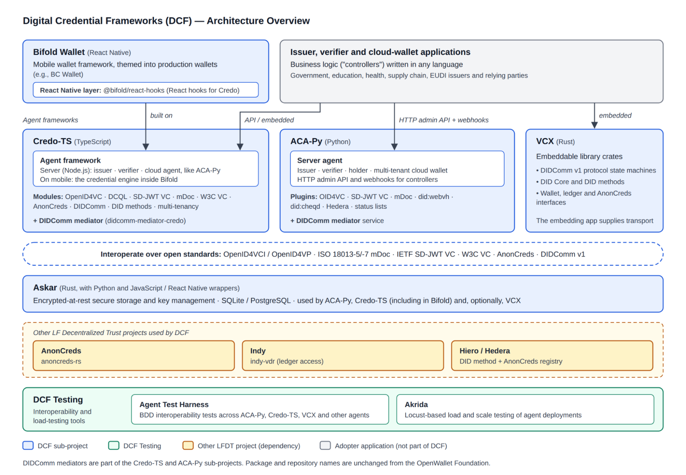

# Sponsor(s)

| Name | Organization | Email | Sub-project(s) |
| :---- | :---- | :---- | :---- |
| Stephen Curran | Cloud Compass Computing | swcurran@cloudcompass.ca | ACA-Py, Askar, DCF Testing |
| Timo Glastra | Animo Solutions |  | Credo-TS, Askar, Bifold Wallet |
| Ariel Gentile | 2060.io |  | Credo-TS, Bifold Wallet |
| Andrew Whitehead | Portage |  | Askar, ACA-Py |
| Jason Leach | BC Gov |  | Bifold Wallet |
| George Mulhearn | Anonyome | gmulhearn@anonyome.com | VCX |
| Emiliano Sune | BC Gov | esune@gov.bc.ca | ACA-Py, Credo-TS, Bifold Wallet |
| Kim Ebert | Indicio PBC | kim@indicio.tech | Akrida |
| Robert Learney | Digital Catapult | robert.learney@digicatapult.org.uk | Credo-TS |

# Abstract

**Digital Credential Frameworks** (DCF) provides production-grade, open source building blocks for issuing, holding and verifying digital credentials: agent frameworks (ACA-Py, Credo-TS, VCX), a mobile wallet (Bifold Wallet), secure storage (Askar), and interoperability testing (DCF Testing), supporting OpenID4VC, DIDComm, SD-JWT VC, mDoc, AnonCreds and W3C VCs.

# Context

DCF brings together a set of OpenWallet Foundation digital credential exchange projects that were initially created under the **Hyperledger Aries** banner. Aries was a Hyperledger (now LF Decentralized Trust) project from 2019 until 2024\. In 2024 its most active repositories moved independently to the OpenWallet Foundation (OWF) under their new names, and the LFDT Aries project was formally archived in 2025 (see the [2025 Q2 Hyperledger Aries report](https://github.com/LF-Decentralized-Trust/governance/pull/142)).

| Sub-project | Former Hyperledger name | Moved to OWF |
| :---- | :---- | :---- |
| ACA-Py | Aries Cloud Agent – Python | 2024 |
| Credo-TS | Aries Framework JavaScript (AFJ) | 2024 |
| VCX | Aries VCX | 2024 |
| Bifold Wallet | Aries Bifold | 2024 |
| Askar | Aries Askar | 2024 |
| DCF Testing (known at OWF as "OWL") | Aries Agent Test Harness, Aries Mobile Test Harness, Aries Akrida | 2024 |

With the OpenWallet Foundation closing, DCF is the proposed shared LFDT home for these projects. The sub-projects have a large overlapping maintainer and contributor base, depend on each other directly (Bifold Wallet is built on Credo-TS, ACA-Py and Credo-TS both use Askar, and DCF Testing tests them against one another), and have always operated as connected community.

**Related LFDT projects:**

* **AnonCreds** — ACA-Py, Credo-TS, VCX and Bifold implement AnonCreds using `anoncreds-rs`. (Dependency; see below.)  
* **Indy** — ACA-Py and Credo-TS use `indy` artifacts for Indy ledger access. (Dependency; see below.)  
* **Hiero / Hedera** — ACA-Py (through the `hedera` plugin in acapy-plugins) and Credo-TS (through the `@credo-ts/hedera` package) support the Hedera DID method and an AnonCreds registry on Hedera.  
* **CREDEBL** — builds its platform on DCF components.  
* **Identus** — a separate LFDT identity stack (DIDComm v2, Cardano/PRISM). The two are complementary, and there is potential for interoperability testing through DCF Testing.  
* **identity-common-ts, eudiplo** (OWF projects also moving to LFDT) — Credo-TS uses or integrates with these.  
* **Trust Over IP (ToIP)** — DCF sub-projects implement the ToIP stack.

# Dependent Projects

The following LFDT projects are dependencies of DCF. Their maintainers' sign-off will be recorded here before TAC consideration.

| LFDT Project | Component(s) used | Used by | Sign-off |
| :---- | :---- | :---- | :---- |
| AnonCreds | anoncreds-rs and its wrappers | ACA-Py, Credo-TS, VCX, Bifold Wallet | Stephen Curran |
| Indy | Various indy components and wrappers | ACA-Py, Credo-TS, VCX | Kim Ebert, Wade Barnes |

No existing LFDT project covers the same scope. The former home of this work, Hyperledger Aries, is archived.

# Motivation

Digital credentials are rapidly becoming mandatory infrastructure. The clearest example is the EU Digital Identity Wallet (EUDI Wallet) under eIDAS 2.0, which requires every EU Member State to offer citizens a wallet and requires relying parties across the EU to accept it. Alongside it are ISO mobile driving licences (mDL) and government, education, health and supply-chain credential programs worldwide. Organizations building these systems need open, vendor-neutral, standards-compliant components that are ready for production today and that support *several* credential formats and exchange protocols, because deployments must bridge ecosystems.

DCF meets that need with a combination no other open source project offers:

* **Proven in EUDI and in production.** DCF components are already building blocks of the European digital identity ecosystem:  
  * Credo-TS supports the credential formats and protocols required by the EUDI [Architecture and Reference Framework (ARF)](https://eu-digital-identity-wallet.github.io/eudi-doc-architecture-and-reference-framework/): OpenID4VCI, OpenID4VP 1.0 with DCQL, ISO 18013-5 mDoc, ISO 18013-7 and IETF SD-JWT VC. It can be used to build EUDI wallets as well as EUDI issuers and relying parties.  
  * The **EasyPID** wallet, built on Credo-TS by Animo, was a prototype EUDI Wallet for SPRIN-D (the German Federal Agency for Breakthrough Innovation) in its "Funke" EUDI wallet competition. The open source **Paradym EUDI Prototype Wallet** is built on the same stack.  
  * Ireland's OGCIO uses Credo-TS for the **gov.ie Digital Wallet** pilot, aligning with the ARF through Credo's OpenID4VC and SD-JWT VC support.  
  * ACA-Py provides EUDI-compatible issuance and verification (OpenID4VCI / OpenID4VP, SD-JWT VC, mDoc) through its OID4VC plugin.  
* Beyond the EU, DCF runs government-scale deployments: the BC Wallet and Government of British Columbia credential ecosystem, the Manitoba digital credential program, and deployments in the US, South Africa, Brazil and elsewhere.  
* **Multi-protocol and multi-format through plugins and modules.** DCF components support OpenID4VCI / OpenID4VP 1.0, DIDComm v1 (Aries Interop Profile 2.0), ISO 18013-5/-7 mDoc, IETF SD-JWT VC, W3C VCDM 1.1/2.0, and AnonCreds. They also cover a broad set of DID methods (`did:web`, `did:webvh`, `did:key`, `did:jwk`, `did:peer`, `did:indy`, `did:cheqd`, `did:hedera`, and more) and credential status mechanisms (IETF Token Status List, W3C Bitstring Status List, AnonCreds revocation). The key design choice is extensibility: ACA-Py's **plugin** architecture and Credo-TS's **module** system let new protocols, formats, DID methods and ledgers be added without changing the core. That is how the frameworks have evolved steadily over **seven years** as the digital credential landscape changed, from purely DIDComm and AnonCreds on Hyperledger Indy, to AnonCreds rooted in many places, to W3C VCs, to OpenID4VC, SD-JWT VC and mDoc for EUDI, without forcing adopters to re-platform.  
* **A complete stack in the languages implementers use.** Python (ACA-Py) and TypeScript (Credo-TS) for issuers, verifiers and cloud agents; TypeScript/React Native (Credo-TS, Bifold Wallet) for mobile wallets; Rust (VCX, Askar) for embedded and native use; plus interoperability and load testing.  
* **A mature, multi-organization community** with seven years of continuous development, regular releases, long-term-support (LTS) branches, and public community calls.

Placing these projects together in LFDT puts production digital credential tooling alongside LFDT's existing trust infrastructure (AnonCreds, Indy, Hiero, Identus, CREDEBL, Besu and Fabric). That makes LFDT a single, coherent home for the decentralized trust and digital wallet communities, which is the stated goal of the OWF–LFDT combination.

A single umbrella project, instead of five or more separate proposals, is proposed because:

* the sub-projects share a common maintainers and contributors community;  
* they are tightly coupled technically, operating both independently and in concert where useful;  
* **one GitHub organization** for all DCF repositories gives one place for access control, maintainer teams, security settings, CI policies, OpenSSF Scorecard and repository-structure compliance, instead of repeating that setup for each project;  
* **reduced administrative overhead** for maintainers and for LFDT: one TSC, one charter, one set of governance documents, one annual and mid-year report to the TAC, and one point of contact for LFDT staff; and  
* the combined project comfortably meets LFDT's diversity, activity and release criteria, while still allowing each sub-project to be assessed on its own maturity.

# Status

**Requested status: Graduated.**

DCF's major sub-projects have 5–7 years of continuous development under Linux Foundation governance (Hyperledger 2019–2024, OWF 2024–2026), where they operated as mature projects. The request is backed by the evidence against LFDT's [Incubation Exit Criteria](https://lf-decentralized-trust.github.io/governance/governing-documents/project-incubation-exit.html) in the [Graduation Criteria Evidence](#graduation-criteria-evidence) section below.

In line with the TAC's current discussion of projects that span several maturity levels, DCF proposes that each sub-project's maturity be tracked individually within the project:

| Sub-project | Proposed internal maturity | Rationale |
| :---- | :---- | :---- |
| ACA-Py (incl. plugins, mediator service and related repos) | Graduated | 570 commits / 32 authors / 33 release tags in the last 12 months; LTS program; docs site |
| Credo-TS (incl. extensions and mediator) | Graduated | 324 commits / 29 authors in the last 12 months; continuous releases; docs site |
| Bifold Wallet | Graduated | 185 commits / 15 authors / 54 release tags in the last 12 months; production wallets built on it |
| Askar | Graduated (stable / maintenance) | Core dependency of ACA-Py and Credo-TS; 63 commits / 7 authors; releases 0.4.6 and 0.5.0 in the last 12 months |
| DCF Testing | Graduated (supporting tooling) | Interoperability and load-testing tooling used across the sub-projects |
| VCX | Incubation | 5 commits / 3 authors / 1 release in the last 12 months; production wallets built on it |

# Solution

## Architectural Overview

NOTE: Credo-TS has two roles in DCF. It is the basis of the Bifold mobile wallet (running in React Native), and it is also used on its own as a server-side (Node.js) issuer, verifier and cloud agent framework, the TypeScript counterpart of ACA-Py.

## Sub-projects

**Credo-TS** ([credo.js.org](https://credo.js.org/), TypeScript, Apache-2.0). A framework for building decentralized identity solutions on Node.js (server-side issuers, verifiers and cloud agents) and React Native (mobile wallets), with no lock-in to any exchange protocol, credential format, signature suite or DID method. Its module system provides OpenID4VCI / OpenID4VP 1.0, DCQL, SD-JWT VC, mDoc, W3C VCDM, AnonCreds, DIDComm v1 (AIP 1 & 2), an extensible DID resolver/registrar (including Hedera), and multi-tenancy. It is published to npm as `@credo-ts/*` packages.

**Bifold Wallet** (React Native, TypeScript, Apache-2.0). An open source mobile wallet framework built on Credo-TS, designed to be themed and extended into branded production wallets. It supports OID4VCI and OID4VP 1.0, ISO 18013-7 Annex B, DIDComm v1 (AIP 2), and AnonCreds / SD-JWT VC / mDoc / W3C VCDM credentials. Production wallets built on Bifold include BC Wallet (British Columbia), MB Wallet (Manitoba)  and wallets in Brazil. The [Harvard Applied Social Media Lab’s Keyring Wallet](https://asml.cyber.harvard.edu/advanced-digital-identity/) is a fork of Bifold Wallet. The current OWL Mobile Wallet test harness will be included with Bifold in the proposed transition to LFDT.

**ACA-Py** ([aca-py.org](https://aca-py.org/), Python, Apache-2.0). A foundation for building non-mobile decentralized trust services (issuers, verifiers, holders, mediators and multi-tenant cloud wallets). Business logic lives in a "controller" in any language, which talks to ACA-Py over an HTTP admin API and webhooks. The plugin architecture ([plugins.aca-py.org](https://plugins.aca-py.org/)) has let ACA-Py add OpenID4VC, SD-JWT VC, mDoc, `did:webvh`, `did:cheqd`, Hedera, status lists, Redis eventing and more without changes to the core. It is compliant with Aries Interop Profile 2.0 and supports AnonCreds, W3C VCDM 2.0 and DIDComm v1. LTS branches (currently 1.3 and 1.6) receive ongoing patch releases, and artifacts are published to PyPI and GHCR.

**Askar** (Rust with Python and JavaScript/React Native wrappers; Apache-2.0). Encrypted-at-rest secure storage and key management with SQLite and PostgreSQL back ends. It is the default storage and KMS for ACA-Py and Credo-TS, and succeeded the Indy SDK wallet. While both ACA-Py and Credo-TS are moving away from Askar for secure storage, both continue to use its Key Management Service (KMS) capabilities.

**VCX** (Rust, Apache-2.0). Rust crates for DIDComm-based applications: `aries_vcx` (DIDComm protocols for credential issuance and verification), `messages`, DID Core crates (`did_doc`, `did_parser`), and DID method implementations (`did:peer`, `did:sov`, `did:cheqd`, `did:web`, `did:key`, `did:jwk`).

**DCF Testing** (Python / BDD, Apache-2.0). A community interoperability and quality "lab" for digital credential frameworks (currently the “OWL” project at OWF). It includes the Agent Test Harness (BDD-based interoperability tests that run real ACA-Py, Credo-TS and other agents against one another using standard protocols), and Akrida (Locust-based load testing of agent deployments). Sub-projects and adopters use it to check interoperability and scale.

### **Repositories in scope** {#repositories-in-scope}

| Sub-project | Repositories |
| :---- | :---- |
| DCF Governance | Governance (TSC, GitHub repos/teams config.yaml, etc.) |
| Credo-TS | credo-ts, credo-ts-ext, credo-ts-didcomm-ext, credo-ts-docs, didcomm-mediator-credo |
| Bifold | bifold-wallet |
| ACA-Py | acapy, acapy-plugins, acapy-vc-authn-oidc, acapy-endorser-service, acapy-tools, didcomm-mediator-service |
| Askar | askar, askar-wrapper-javascript |
| VCX | vcx |
| DCF Testing | interop-test-harness (currently owl-agent-test-harness, akrida (currently owl-akrida) |

All DCF repositories will live in **a single GitHub organization** (e.g., `github.com/digital-credential-frameworks` ), managed through one governance/access-control configuration. Repository names are kept to avoid breaking package registries, container images and downstream imports. Existing package names (`acapy-agent` on PyPI, `@credo-ts/*` and `@bifold/*` on npm, and so on) are unchanged as much as possible.

## Governance

* DCF is proposed to be governed by a **Technical Steering Committee (TSC)** under an LFDT technical charter.  
* **Sub-project autonomy:** each sub-project keeps its name, maintainers, contribution process, release cadence and roadmap, as documented in its own `MAINTAINERS.md` and `CONTRIBUTING.md`.  
* **TSC composition:** will include at least one maintainer from each major sub-project (ACA-Py, Credo-TS, Bifold, Askar), plus one seat shared by the smaller sub-projects, with no more than 1/3 of seats held by any one organization.  
* **TSC responsibilities:** cross-project matters only — LFDT reporting (a single annual/mid-year report covering all sub-projects), the GitHub organization and its shared settings, the security response process, repository-structure compliance, adding or retiring sub-projects, and shared infrastructure (DCF Testing, CI, docs hosting, Discord).  
* **Sub-project lifecycle within DCF:** a sub-project that stops meeting the criteria can be moved to maintenance, LFDT Labs or archive by TSC vote, without affecting the rest of DCF.

## Standards and backward compatibility

DCF implements open standards and does not change any ledger or network protocol. The move from OWF to LFDT is administrative: no API, protocol or package changes are needed for adopters. Releases continue to follow semantic versioning. Credo-TS and ACA-Py's LTS programs continue, and existing LTS commitments are honored.

## Addressing likely objections

* *"Why one project and not several?"* See [Motivation](https://claude.ai/cowork/cse_016vGM1xNkwBi7oSkEmXhmEt#motivation). The sub-projects share a community and are tightly coupled. One organization and one TSC cut administrative overhead, and the umbrella makes each sub-project's maturity visible instead of hiding it.  
* *"Why not join an existing LFDT project (e.g., Identus or CREDEBL)?"* Those projects serve different architectural niches (Identus is a DIDComm v2 / PRISM stack; CREDEBL is a platform that *consumes* DCF components). DCF supplies the frameworks that both can build on and interoperate with, but are lower level components.  
* *"Are all sub-projects at the same maturity?"* No. Credo-TS, Bifold Wallet and ACA-Py are very mature and continue to evolve. Askar is mature, stable and maintained to support the larger sub-projects. VCX has a smaller, less active maintainer set. The test tools evolve intermittently as they are needed by maintainers and adapters during roll outs.  
* Others to be added…

### **License**

All code is licensed under **Apache-2.0**. Third-party dependencies are Apache-2.0 compatible and will be checked against LFDT's [allowed third-party licenses](https://lf-decentralized-trust.github.io/governance/governing-documents/allowed-third-party-licenses.html).

### **Trademarks**

"Digital Credential Frameworks" is **intentionally generic**. It is a descriptive umbrella term for the collection, not a brand, and DCF does not intend to build a separate brand around it. The **sub-project names are the important branding**: Credo, Bifold Wallet, ACA-Py, Askar and VCX are the names adopters, packages and documentation already use, and they are kept unchanged. Using a descriptive umbrella name avoids the branding and trademark problems of creating one new brand for a group of well-known sub-projects.

## Graduation Criteria Evidence {#graduation-criteria-evidence}

*Evidence against the [Incubation Exit Criteria](https://lf-decentralized-trust.github.io/governance/governing-documents/project-incubation-exit.html) and the [Project Lifecycle](https://lf-decentralized-trust.github.io/governance/governing-documents/project-lifecycle.html) criteria. Figures cover September 27, 2025 – September 27, 2026 and come from the public Git history.*

### **Legal**

* All code is under Apache-2.0.  
* OpenSSF Scores:  
  * Credo-TS: [6.1](https://scorecard.dev/viewer/?uri=github.com/openwallet-foundation/credo-ts)  
  * Bifold Wallet: [6.5](https://scorecard.dev/viewer/?uri=github.com/openwallet-foundation/bifold-wallet)  
  * ACA-Py: [8.0](https://scorecard.dev/viewer/?uri=github.com/openwallet-foundation/acapy)  
  * Askar: [5.5](https://scorecard.dev/viewer/?uri=github.com/openwallet-foundation/askar)  
  * VCX: [7.0](https://scorecard.dev/viewer/?uri=github.com/openwallet-foundation/vcx)  
* Name trademark check: see Trademarks.

### **Diversity**

Maintainer organizations across DCF include: Cloud Compass Computing, Portage CyberTech, Animo Solutions, 2060.io, Anonyome Labs, Government of British Columbia, Province of Ontario, Cloud Compass Computing, Portage CyberTech, Digital Catapult, OpSecId, and others. This is well over the **≥3 organizations** required for Graduated status.

Commits in the last 12 months also came from contributors at (per commit email domains) animo.id, ontario.ca, opsecid.ca, verid.id, northernblock.io, digicatapult.org.uk, ayanworks.com, fullboar.ca, and many independent contributors.

| Repo | Commits (12 mo) | Unique authors (12 mo) | Release tags (12 mo) | Latest release |
| :---- | :---- | :---- | :---- | :---- |
| credo-ts | 324 | 29 | continuous (alpha/PR builds) | 0.7.x, 0.8 pending |
| bifold-wallet | 185 | 15 | 54 | v3.1.1 (Sep 25, 2026\) |
| acapy | 570 | 32 | 33 | 1.7.0 (Sep 15, 2026\) |
| askar | 63 | 7 | 2 | v0.5.0 (Dec 11, 2025\) |
| didcomm-mediator-credo (Credo-TS) | 17 | 6 | 4 | v0.0.2-alpha (Dec 2025\) |
| vcx | 5 | 3 | 1 | 0.68.0 (Aug 17, 2026\) |

### **Releases**

Several sub-projects far exceed the "≥2 releases in the past year" requirement (acapy: 33 tags; bifold-wallet: 54 tags). Releases are published to PyPI (`acapy-agent`), npm (`@credo-ts/*`, `@bifold/*`), GHCR container images, and GitHub Releases. ACA-Py runs a documented [LTS strategy](https://github.com/openwallet-foundation/acapy/blob/main/LTS-Strategy.md) and [publishing process](https://aca-py.org/latest/PUBLISHING/).

###  **Testing and Q/A**

* Unit and integration test suites run on every PR through GitHub Actions in all major repos. Credo-TS reports coverage through Codecov.  
* Cross-implementation interoperability testing is available through the DCF Testing Agent Test Harness.  
* Load and scale testing is done with Akrida (Locust-based load generation).  
* acapy-plugins runs a CI pipeline that re-tests every plugin against each new ACA-Py release.

### **Security**

* `SECURITY.md` is present in acapy, askar and credo-ts.  
* Private vulnerability reporting is enabled through GitHub Security Advisories. Dependabot/Renovate is enabled in most repos.  
* OpenSSF Scorecard workflow is present in acapy, askar, bifold-wallet and credo-ts.  
* Custom dependabot management tools are implemented in ACA-Py Plugins where 25+ dependabot PRs arrive and are applied weekly with \~10 minutes effort.

### **Structure**

The project maintainers commit to ensuring that any sub-project repos that don’t meet the LFDT [repository structure guidelines](https://lf-decentralized-trust.github.io/governance/governing-documents/repository-structure.html) and GitHub Community Standards (README, LICENSE, CONTRIBUTING, CODE\_OF\_CONDUCT, SECURITY, MAINTAINERS, CHANGELOG) will be updated. Most already meet the guidelines. A single GitHub organization will let these checks be applied and monitored consistently.

### **Maintenance**

Activity is high across the major sub-projects (above), with PR review required before merge. Public bi-weekly community calls are currently held by OWF for Credo-TS, Bifold Wallet and ACA-Py. OWF Discord channels are: `#credo`, `#bifold`, `#aca-py`, `#vcx`, `#askar`

### **Production**

Known production and pilot use includes the EUDI-focused deployments described in [Motivation](#motivation) (SPRIN-D EasyPID prototype, the Paradym EUDI Prototype Wallet, the gov.ie Digital Wallet pilot) and government digital credential programs in British Columbia, and Manitoba (Canada), plus deployments in the US, South Africa and Brazil. See also the LFDT case studiesy [*Infosys Boosts Efficiency, Security, and Privacy of Credential Verification with Hyperledger Indy and ACA-Py*](https://www.lfdecentralizedtrust.org/blog/infosys-boosts-efficiency-security-and-privacy-of-credential-verification-with-hyperledger-indy-and-aca-py).

### **Documentation (beyond GitHub)**

* ACA-Py: [aca-py.org](https://aca-py.org/); plugins: [plugins.aca-py.org](https://plugins.aca-py.org/)  
* Credo-TS: [credo.js.org](https://credo.js.org/)

# Effort and Resources

| Sub-project | Maintainers (GitHub) | Organizations |
| :---- | :---- | :---- |
| Credo-TS (incl. mediator) | TimoGlastra, genaris, jakubkoci, auer-martin, berendsliedrecht, hacdias, rmlearney-digicatapult, jleach, sairanjit, GHkrishna | Animo Solutions, 2060.io, Digital Catapult, BC Gov, and others. |
| Bifold Wallet | jleach, bryce-mcmath, cvarjao, al-rosenthal, fc-santos, jcdrouin21, KjartanE, MacDeluca, MosCD3, LippaC-OPS, thiagoromanos | BC Gov, 2060.io, Gov. of Ontario |
| ACA-Py (incl. mediator service) | swcurran, andrewwhitehead, TimoGlastra, WadeBarnes, esune, jamshale, ff137, thiagoromanos, PatStLouis, loneil, Gavinok | BC Gov, Gov. of Ontario, Quartech, Indicio, CQPD, Cloud Compass Computing, OpSecID, Portage CyberTech, Northern Block |
| Askar | andrewwhitehead, TimoGlastra, WadeBarnes, swcurran, berendsliedrecht, genaris, cvarjao | Portage CyperTech, Animo Solutions, Cloud Compass Computing, 2060.io |
| VCX | gmulhearn | Anonyome Labs |
| DCF Testing | PatStLouis, KimEbert42, swcurran, jamshale, genaris, WadeBarnes, Jsyro, al-rosenthal | BC Gov, Indicio, Cloud Compass Computing, OpSecID |

Committed resources include ongoing engineering from the Government of British Columbia and its partners, Animo Solutions, 2060.io, Portage CyberTech, CPQD, Cloud Compass Computing, Anonyome,

## Timeline

| Milestone | Target date |
| :---- | :---- |
| Seed announcement on the LFDT TAC mailing list | October 2026 |
| Dependent-project sign-offs (AnonCreds, Indy) | October 2026 |
| Proposal PR opened | October 2026 |
| TAC review and decision | November 2026 |
| Repository transfer to the DCF GitHub organization; CI, Discord and docs migration | December 2026 – January 2027 |
| OWF merger effective | January 1, 2027 |
| Close repository-structure / OpenSSF gaps | By end of Q1 2027 |
| First DCF report to the TAC | Per the TAC calendar |

# How To

Extensive documentation is available on using each of the sub-projects. Documentation has always been a priority for each. In brief:

* **Credo-TS:** `npm install @credo-ts/core @credo-ts/node` (server) or `@credo-ts/react-native` (mobile). Getting started: [credo.js.org](https://credo.js.org/). Credo-based mediator: the `didcomm-mediator-credo` container image on GHCR.  
* **Bifold:** clone [bifold-wallet](https://github.com/openwallet-foundation/bifold-wallet), follow the developer guide in the README, and run it on the iOS / Android simulators.  
* **ACA-Py:** `pip install acapy-agent` or `ghcr.io/openwallet-foundation/acapy-agent`. Getting started: [aca-py.org](https://aca-py.org/) and the [demo](https://github.com/openwallet-foundation/acapy/blob/main/docs/demo/README.md). ACA-Py-based mediator: `didcomm-mediator-service`.  
* **Askar:** used automatically by ACA-Py and Credo-TS. Direct use is via the Rust crate or the Python / JS wrappers.  
* **VCX:** consume the crates as GitHub Cargo dependencies (see the repository README).  
* **How we know it works:** per-repo CI (unit and integration tests), DCF Testing interoperability and load tests, and production deployments.

# References

*References. See [citation guide](http://www.chicagomanualofstyle.org/tools_citationguide.html).*

* LF Decentralized Trust. "Project Proposal Process." [https\://lf-decentralized-trust.github.io/project-proposals/](https://lf-decentralized-trust.github.io/project-proposals/)  
* LF Decentralized Trust TAC. "Project Lifecycle." [https\://lf-decentralized-trust.github.io/governance/governing-documents/project-lifecycle.html](https://lf-decentralized-trust.github.io/governance/governing-documents/project-lifecycle.html)  
* LF Decentralized Trust TAC. "Project Incubation Exit Criteria." [https\://lf-decentralized-trust.github.io/governance/governing-documents/project-incubation-exit.html](https://lf-decentralized-trust.github.io/governance/governing-documents/project-incubation-exit.html)  
* LF Decentralized Trust. "OpenWallet Foundation to Move to LF Decentralized Trust." September 1, 2026\. [https\://www\.lfdecentralizedtrust.org/announcements/openwallet-foundation-to-move-to-lf-decentralized-trust](https://www.lfdecentralizedtrust.org/announcements/openwallet-foundation-to-move-to-lf-decentralized-trust)  
* OpenWallet Foundation. "Credo: Heading Into 2025, Releases 0.5 and 0.6, and How We're Becoming a Central Player in Global Interoperability." February 5, 2025\. [https\://openwallet.foundation/2025/02/05/credo-heading-into-2025-releases-0-5-and-0-6-and-how-were-becoming-a-central-player-in-global-interoperability/](https://openwallet.foundation/2025/02/05/credo-heading-into-2025-releases-0-5-and-0-6-and-how-were-becoming-a-central-player-in-global-interoperability/)  
* Paradym (Animo Solutions). "Competing to Build the Best European Digital Identity Wallet." [https\://paradym.id/articles/competing-to-build-the-best-european-wallet](https://paradym.id/articles/competing-to-build-the-best-european-wallet)  
* Paradym (Animo Solutions). "The Paradym EUDI Prototype Wallet." [https\://paradym.id/products/paradym-eudi-prototype-wallet](https://paradym.id/products/paradym-eudi-prototype-wallet)  
* Manitoba Wallet. [https\://apps.apple.com/ca/app/mb-wallet/id6738668460](https://apps.apple.com/ca/app/mb-wallet/id6738668460) from the Province of Manitoba   
* OpenWallet Foundation. "ACA-Py OWF Project Mapping." [https\://github.com/openwallet-foundation/acapy/blob/main/ACA-Py-OWF-Project-Mapping.md](https://github.com/openwallet-foundation/acapy/blob/main/ACA-Py-OWF-Project-Mapping.md)  
* Hyperledger Aries. "2025 Q2 Hyperledger Aries Report." [https\://github.com/LF-Decentralized-Trust/governance/pull/142](https://github.com/LF-Decentralized-Trust/governance/pull/142)  
* Project repositories: [https\://github.com/openwallet-foundation](https://github.com/openwallet-foundation) (acapy, credo-ts, bifold-wallet, askar, vcx, owl, and others)

# Closure

*Closure how do we know that the project succeeded. This has to be measurable if possible. Make references to successor projects if any.*

DCF will be considered successful when:

1. All in-scope repositories have moved into the single DCF GitHub organization at LFDT with no disruption to published packages or adopters (target: Q1 2027). The new GitHub organization will have a functioning repo / GitHub teams config.yaml file to manage the Maintainer lists.  
2. Every active DCF repository meets the LFDT MUST-level OpenSSF Scorecard criteria, and the major sub-projects hold an OpenSSF Best Practices badge (target: mid-2027).  
3. The DCF TSC is formalized with periodic meetings schedule and occurring.  
4. The major sub-projects each ship at least 4 releases a year, ACA-Py continues its LTS program, and other sub-projects consider formalizing their LTS process.  
5. `ADOPTERS.md` files list at least 10 permission-cleared production adopters across DCF, including EUDI deployments.  
6. DCF components remain aligned as various Digital Credential protocols and credential formats gain importance and acceptance. “The Only Certainty in Digital Credentials is Uncertainty.”  
7. VCX either reaches the Graduated bar within DCF or is deliberately moved to Labs or archived by TSC decision.
