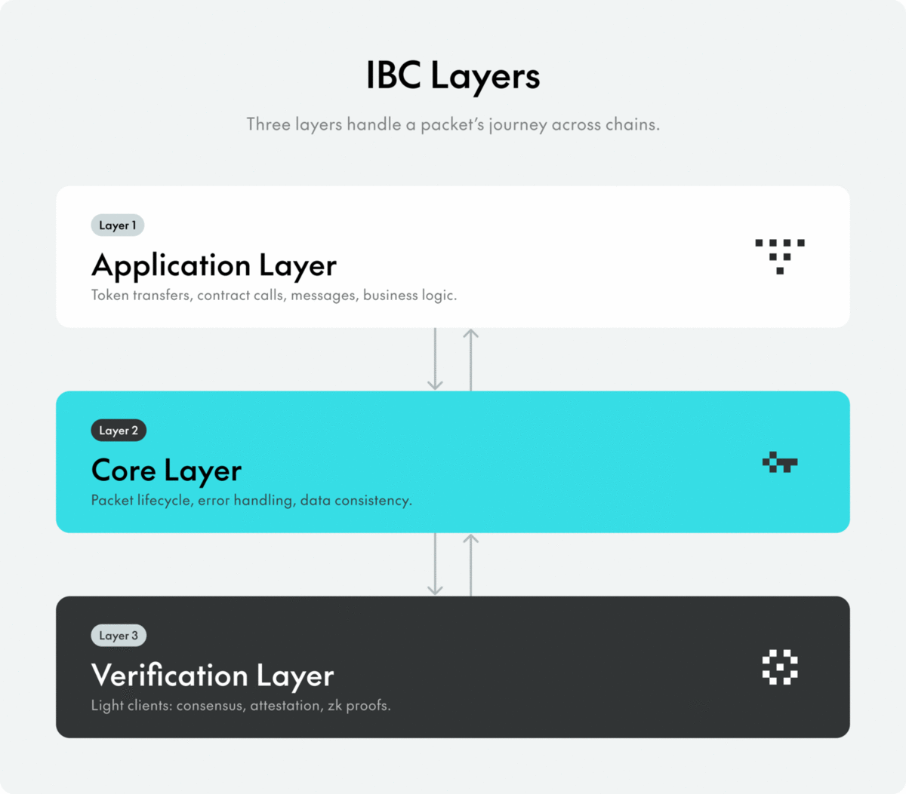
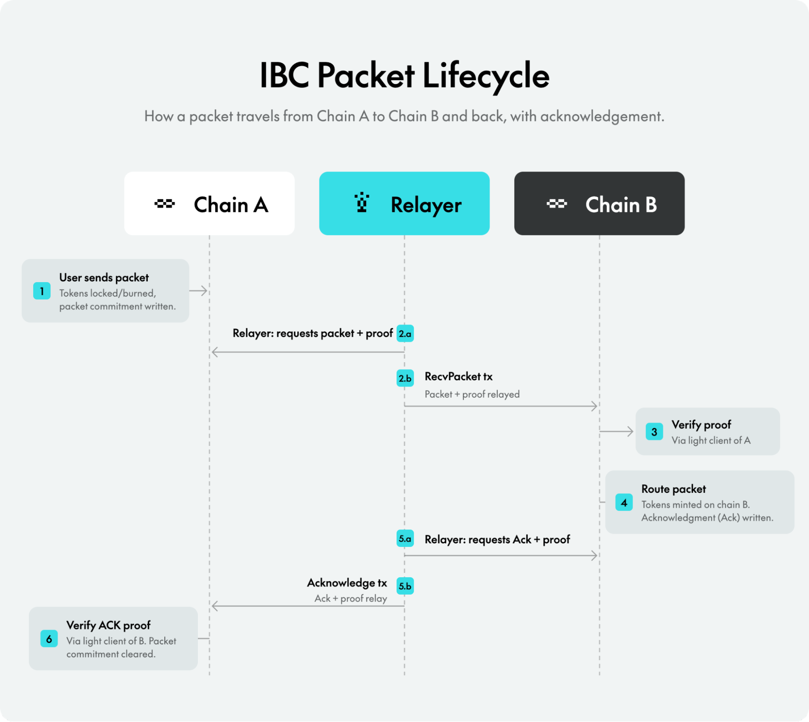
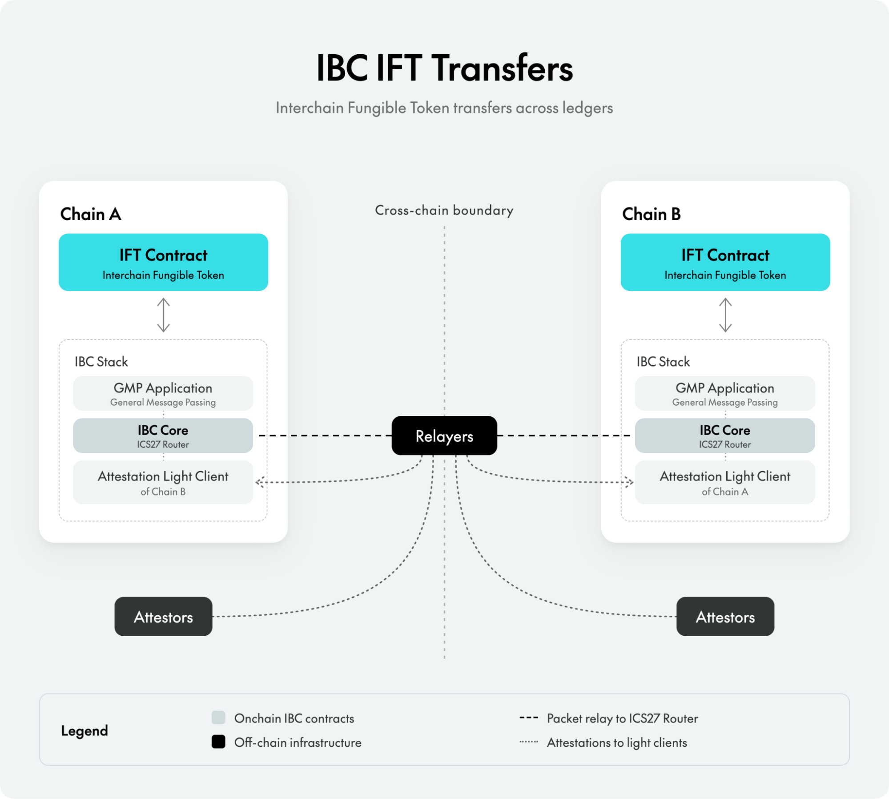

# Linux Foundation Decentralized Trust Inter-Blockchain Communication (IBC) Protocol Proposal

# Sponsor(s)

**Agoric Systems**
- Dean Tribble, CEO, [tribble@agoric.com](mailto:tribble@agoric.com)

**Blockaid**
- Ido Ben-Natan, CEO, [ido@blockaid.co](mailto:ido@blockaid.co)

**Cardano Foundation**
- Fabian Bormann, Head of Ecosystem Engineering, [fabian.bormann@cardanofoundation.org](mailto:fabian.bormann@cardanofoundation.org)

**Cosmos Labs**
- Barry Plunkett, CEO, [barry@cosmoslabs.io](mailto:barry@cosmoslabs.io)

**Cronos Labs**
- Ryan Wyatt, CEO, [ryan.wyatt@cronoslabs.org](mailto:ryan.wyatt@cronoslabs.org)

**Datachain**
- Daiki Ishikawa, Executive Officer, Head of Business Development, [daiki.ishikawa@datachain.jp](mailto:daiki.ishikawa@datachain.jp)

**Espresso Systems**
- Ellie Davidson, Chief Product Officer, [ellie@espressosys.com](mailto:ellie@espressosys.com)

**Figure Markets**
- June Ou, President, [june@figuremarkets.com](mailto:june@figuremarkets.com)
- Matt Conroy, CTO, [matt@figuremarkets.com](mailto:matt@figuremarkets.com)

**Google Cloud**
- Moritz Platt, Principal Solutions Architect, Google Cloud Universal Ledger, [moritzp@google.com](mailto:moritzp@google.com)
- Ishan Singh, Senior Principal, Google Cloud Universal Ledger, [ishansg@google.com](mailto:ishansg@google.com)

**Hypernative**
- Alex Rabke, SVP Global Sales & GTM, [alex@hypernative.io](mailto:alex@hypernative.io)

**Hypha**
- Udit Vera, Co-Founder, [udit@hypha.coop](mailto:udit@hypha.coop)

**Injective Labs**
- Eric Chen, Co-founder & CEO, [eric@injectivelabs.org](mailto:eric@injectivelabs.org)

**Interchain Foundation**
- Josh Cincinnati, Vice President of the Board of Directors, [josh@interchain.io](mailto:josh@interchain.io)
- Matthew Matuszak, COO, [matthew@interchain.io](mailto:matthew@interchain.io)

**Iqlusion**
- Zaki Manian, Co-Founder, [zaki@iqlusion.io](mailto:zaki@iqlusion.io)
- Kristi Poldsam, Cofounder, [kristi@iqlusion.io](mailto:kristi@iqlusion.io)
- Shella Stevens, Cofounder, [shella@iqlusion.io](mailto:shella@iqlusion.io)
- Tony Arcieri, Cofounder, [tony@iqlusion.io](mailto:tony@iqlusion.io)

**OpenZeppelin**
- Jonathan Alexander, CTO, [jonathan@openzeppelin.com](mailto:jonathan@openzeppelin.com)
- Andrew Levy, Head of Standards, [andrew.levy@openzeppelin.com](mailto:andrew.levy@openzeppelin.com)

**Partior**
- Krishnan Narayanan, Head of Technology, [krishnan.narayanan@partior.com](mailto:krishnan.narayanan@partior.com)

**Range**
- Andres Monteoliva, CEO, [andres@range.org](mailto:andres@range.org)

**Regen Network**
- Gregory Landua, CEO, [gregory@regen.network](mailto:gregory@regen.network)

**Peersyst**
- Ferran Prat, CEO, [fprat@peersyst.com](mailto:fprat@peersyst.com)

**Turnkey**
- Mike Reinhart, Product & GTM, Turnkey Verifiable Cloud (TVC), [mike.reinhart@turnkey.io](mailto:mike.reinhart@turnkey.io)
- Michael Lewellen, Head of Solutions Engineering, [mike@turnkey.io](mailto:mike@turnkey.io)

**Wells Fargo**
- Vitaliy Dorum, Head of Digital Assets Platform, [vitaliy.dorum@wellsfargo.com](mailto:vitaliy.dorum@wellsfargo.com)

**Zeeve**
- Dr. Ravi Chamria, Co-founder & CEO, [ravi@zeeve.io](mailto:ravi@zeeve.io)
- Ghan Vashishtha, Co-founder & CTO, [ghan@zeeve.io](mailto:ghan@zeeve.io)
- Thomas Abraham, Co-founder & CRO, [thomas.abraham@zeeve.io](mailto:thomas.abraham@zeeve.io)

**Zenith**
- Heslin Kim, Co-founder and CBO, [heslin.kim@zenith.network](mailto:heslin.kim@zenith.network)

# Abstract

The Inter-Blockchain Communication Protocol (IBC) is a battle-tested, extensible, trust-minimized interoperability protocol that connects 190+ public blockchain networks (Mapofzones.com), plus private networks and consortia. In five years of production, it has processed $50B+ in transaction volume without an exploit of the supported version. IBC is an open standard that lets digital ledgers exchange assets and data directly with other ledgers, including Ethereum and EVM-based frameworks such as Hyperledger Besu, non-Ethereum ledgers, and other systems that meet a small set of requirements. We propose contributing IBC to LFDT to provide the open source ecosystem with a neutral and battle-tested solution for DLT interoperability.

# Context

IBC was originally developed for the Cosmos blockchain ecosystem. The protocol is fully open source and has been independently adopted across a wide range of blockchain ecosystems. While many Cosmos ecosystem teams have contributed to IBC, its governance and stewardship are managed by the Interchain Foundation. This proposal brings IBC under vendor-neutral LFDT governance as a broadly owned community standard.

Today, IBC supports interoperability across Cosmos chains, [Ethereum and EVM networks](https://github.com/cosmos/ibc-contracts) (including Hyperledger Besu), Solana, and others. Its EVM implementation enables interoperability for Hyperledger Besu-based blockchains, a natural complement to existing LFDT infrastructure and a strong candidate for cross-project collaboration within the Foundation. It is currently hosted under the [cosmos GitHub organization](https://github.com/cosmos/) and defines a standard messaging protocol for trust-minimized communication between independent blockchain networks.

Interoperability is among the hardest challenges in DLT adoption. LFDT working groups and member organizations have [consistently](https://www.lfdecentralizedtrust.org/interoperability-workshop-2025) [identified](https://www.lfdecentralizedtrust.org/blog/lf-decentralized-trust-at-one-accelerating-innovation-collaboration-and-opportunity) the ability to move value and data across heterogeneous networks as a critical requirement for production-grade deployments. IBC has real-world adoption across financial infrastructure providers on public blockchains including Figure, Progmat, and Ripple's XRPL, broad web3 ecosystem adoption across [Fetch.ai](http://Fetch.ai), [Crypto.com](http://Crypto.com), Injective, and more than 190 networks, and many more institutional users who leverage IBC in private and permissioned contexts. This contribution is intended to help expand the set of IBC contributors and users through open governance.

# Dependent Projects

IBC does not have dependent projects, though it can interoperate with many existing LFDT projects, like Besu, Cacti, and others.

# Motivation

## The need for neutral messaging standards in digital ledger interoperability

Interoperability between heterogeneous blockchain networks is a recurrent problem in DLT adoption. Moving value and data across independent networks, consortia, and other systems is a required capability for digital ledgers, as the number of ledgers in the market continues to grow. Without it, the users of a blockchain network are not able to benefit from the markets and assets that exist on other networks. Today, there is no single proven interoperability standard that offers flexible and secure cross-ledger messaging in a package that is open source, free to use, and community-governed rather than privately-owned. Developers and organizations building on DLT need a standard that is both highly capable, deeply proven, and completely free.

IBC is well positioned to meet these requirements. Today, it consists of 1) a set of composable messaging standards that define how independent DLTs can communicate with no in-protocol fee, token, or oracle required in the standard, 2) a collection of implementations for those standards in common smart contracting languages, and 3) several off-chain infrastructure services that support the protocol. Together, these give any blockchain network, asset issuer, or defi protocol an open, free, and extensible method of communication that supports all major DLT use cases, backed by the technical maturity and operational track record described above.

Despite IBC's strengths, DLT interoperability still faces organizational and ecosystem challenges common to large-scale infrastructure transitions: governance coordination, legal and regulatory uncertainty, and alignment around open technical standards. The Linux Foundation Decentralized Trust is the right steward to make a standard interoperability layer the default across DLT use cases worldwide.

## Why LFDT is the right home

LFDT's stated aim is to accelerate the development and adoption of decentralized trust technologies through open, collaborative governance. This contribution gives LFDT a mature, production-grade interoperability standard that connects otherwise siloed ledger networks and makes cross-project collaboration across and beyond the LFDT portfolio more practical.

IBC can also support the technical development and adoption of other LFDT projects. For example, IBC includes a light client protocol for verifying consensus proofs of Besu ledgers, enabling interoperability of Besu networks with one another and other ledgers without a trusted intermediary. A working group under LFDT gives Besu ecosystem participants, EVM network operators, and other LFDT project communities a natural venue to collaborate on interoperability and expand the set of networks that IBC already supports.

IBC is entirely concerned with transmission of data between distributed ledgers. Because of this, it is naturally complementary to ledger technologies like Fabric and Besu, which are enterprise grade consensus and execution engines. Similarly IBC complements application level interoperability standards like Cacti/SATP, which can be defined and implemented as IBC applications. This enables applications that wish to use those standards to benefit from IBC's data verification modules. See the [section below](#relationship-to-existing-lfdt-interoperability-work) for information on how IBC can complement existing LFDT interoperability projects.

## What the community gains

Bringing IBC to LFDT benefits the broader LFDT and IBC communities in several concrete ways.

First, IBC already supports Besu with multiple verification mechanisms (including a QBFT light client) and application standards (e.g. general message passing), enabling new integration opportunities among Besu users.

Second, IBC also brings its extensive developer ecosystem into LFDT: Developers, validators, and protocol stakeholders who already request features, contribute code, and drive adoption across more than 190 networks. And because many interoperability protocols in production and development today are loosely or explicitly based on IBC, LFDT is positioned as a thought leader in interoperability.

Finally, stewardship across a broader maintainer community reduces long-term dependence on any single organization and encourages contributions from ecosystems outside of Cosmos.

# Status

IBC is a mature, production-grade project being proposed for Incubation under LFDT. It has been in active production for five years, processing $50B+ in transaction volume with no loss of funds across 190+ currently connected public networks, as well as additional private networks and consortia.

## Current State

- *Codebase*: maintained across three repositories. ibc-go holds the core Go implementation for Cosmos SDK chains. ibc holds the protocol specifications and IBC CLI, the relayer and off-chain infrastructure. ibc-contracts holds the Solidity and Solana implementations. Regular releases are published across all three.
- *Production deployments*: IBC is in active production use across a diverse set of deployments including financial infrastructure providers such as Ripple's XRPL, Figure, and Progmat, and broad ecosystem adoption across [Fetch.ai](http://Fetch.ai), [Crypto.com](http://Crypto.com), Injective, and 190+ networks.
- *Contributors*: Currently maintained primarily by Cosmos Labs and Interchain Foundation. Several other organizations are also currently developing contributions to IBC (Zeeve, Open Zeppelin, Datachain) and may participate in governing IBC under the LFDT. IBC has also received contributions from 15+ other organizations historically, several of which are represented among the proposal sponsors.
- *License*: Apache 2.0 currently. The maintainers will migrate the specifications to the [Community Specifications License](https://github.com/CommunitySpecification/Community_Specification/blob/main/01-community-specification-license-v1.md) upon acceptance.
- *Security*: In 5 years, there has been no loss of user funds in the supported, unforked releases of the protocol. Vulnerabilities identified through audits and the bug-bounty program have been resolved through coordinated private disclosure. The current security disclosure process is handled via private channels to affected users of IBC. At this time, the Interchain Foundation finances the bug bounty program, and Cosmos Labs administers it and manages the coordinated, secure release process.

## Incubation to Graduation

Given IBC's production maturity, Cosmos Labs intends to work with the TAC to assess whether IBC qualifies for an accelerated path from Incubation to Graduated status. The following items will be established during incubation to meet graduation criteria:

- ADOPTERS file documenting production deployments
- Public contributor ladder
- Security artifact signing via Sigstore
- Demonstrated growth of maintainer organizations beyond Cosmos Labs

The target for graduation from Incubation to Graduated status is within 12 months of TAC acceptance.

# Relationship to Existing LFDT Interoperability Work

The LFDT already hosts interoperability projects such as Cacti and Smoot. IBC is both complementary to and can expand these projects. At its core, IBC is a protocol for cryptographically secure data verification. Other LFDT applications can leverage this technology and the proven track record that IBC brings to the table.

## Differentiation

|  | **Cacti** | **Smoot** | **CLPR** | **IBC** |
| :- | :- | :- | :- | :- |
| **What it is** | Gateway-to-gateway asset transfer | EEA crosschain framework | Messaging standard | Open standard for trust minimized messaging |
| **Where it runs** | Off-chain gateways | On-chain verifier | On-chain light clients | On-chain light clients |
| **Trust Model** | Gateway signatures trusted | 2-of N multi-signature verifier | cryptographic light clients | Flexible and modular, including cryptographic light clients and oracles |
| **Maturity** | Graduated. Enterprise PoCs | Lab | Lab | 5+ years live. 190+ networks |
| **Best fit** | Regulated gateway enterprise messaging | EVM messaging | Hiero and EVM networks | Cosmos, Solana, and EVM based networks |
| **Relationship to IBC** | Complementary. Can utilize IBC for verification | Similar model with different networks where it spikes, and less maturity/adoption | Similar model with different networks where it spikes, and less maturity/adoption |  |

## Positioning and Collaboration

Cacti and SATP connect ledgers through trusted gateways, where a transfer is accepted because a gateway signs for it. IBC can strengthen that model by verifying transfers with proofs rather than relying on a signature. Feasibility research indicates this is a workable route the project could undertake over time, in collaboration with the Cacti and SATP community. Several IBC maintainers have already begun these discussions with the Cacti maintainers.

Smoot is another good candidate for collaborating with IBC. Both are on-chain frameworks whose design can support proof-based verification. In practice, Smoot ships a trusted multi-signature committee, and its proof-based verification is still experimental. IBC already runs proof-based verification in production, making it a natural integration area for Smoot. The IBC standard and implementation could complement Smoot's production-grade verification mechanisms and vice versa. Additionally, IBC could develop new application-level standards to implement EEA. Several IBC maintainers have already begun these discussions with the Smoot maintainers.

Since CLPR's design is similar to Smoot's, the model for collaborating with CLPR could be the same. CLPR has more mature verification and application level standards for the Hiero/Hedera ecosystem, and IBC could adopt these. Similarly, CLPR could adopt IBC's mature solutions for Besu and Cosmos networks. It's worth noting that like Smoot, CLPR makes several slightly different choices at the protocol layer (e.g. by incorporating relayer fee payment at the protocol layer instead of assuming it happens at the application-level). If CLPR contributors are interested, these differences could be resolved through development of togglable standards, enabling CLPR users to take advantage of IBC's 5+ year track record.

# Solution

## Overview

The Inter-Blockchain Communication Protocol (IBC) is an open standard for trust-minimized message passing between independent blockchain networks. Any two ledgers that implement the standard can exchange arbitrary data — token transfers, account control, contract calls — without a trusted intermediary. The protocol defines data structures, abstractions, and semantics that any distributed ledger meeting a small set of requirements can implement, and IBC can interoperate between digital ledgers and any system that supports signing.

IBC is agnostic to application, programming language / VM, and network architecture. It has support for multiple application standards (e.g. cross-chain smart contract calls, mint-burn transfers) and network architectures today.

Much as TCP/IP standardized communication across the internet, IBC standardizes communication across blockchains and other distributed ledgers. It enables two systems to exchange data, assets, and arbitrary messages directly, without requiring centralized or third-party intermediaries.

## Protocol Architecture

## IBC

IBC is organized into three layers:

**The Application Layer**: the layer that defines how packet data is packaged and interpreted by sending and receiving chains. IBC applications can be thought of as the business logic layer and as a composable set of interoperability building blocks for cross-chain applications. Standard application modules include fungible token transfers (ICS-20), general message passing (IBC GMP), and interchain fungible token (IFT) transfers. These modules allow developers to build reusable cross-chain functionality without needing to reimplement interoperability primitives from scratch.

**The IBC Core Layer**: the routing and authentication layer. A single router verifies and dispatches packets to the correct application, and the client authenticates the data each chain receives. This layer provides the common interoperability infrastructure used to coordinate communication across independent blockchain networks with potentially distinct smart contract languages and security models.

**The Verification Layer**: this layer handles how cross-chain state is proven. The verification layer consists of clients that verify messages across blockchains. Different client architectures are used in this layer, including consensus light clients, attestation-based (i.e. oracles), and zk-proof light clients. This verification model allows IBC to operate across heterogeneous execution environments, including Cosmos, EVM-based, and Solana-based networks.

Together, these layers define both the protocol standard and the production interoperability infrastructure required for secure cross-chain communication. The separation of concerns between layers allows application developers to build cross-chain applications without needing to manage low-level details such as client verification, connection setup, or proof construction.

## Key Characteristics

IBC connects heterogeneous environments, including gas-metered environments such as the EVM. Key characteristics include:

- Light clients are the primary connection primitive between chains. Communication between chains can be cryptographically verified via a pair of light clients that track counterparty chain state. Attestation-based, aka oracle-based, clients are also available.
- A single Router that handles packet routing across all applications.
- Packets that carry one or more Payloads, each specifying source port, destination port, application version, encoding, and raw data. This enables a single packet to carry data for multiple applications simultaneously with atomic execution.
- Timeouts and acknowledgements enable built-in recovery from failure.
- Flexible client types, including ZK-proof verifiers, attestation-based, and conditional clients, enable deployments across a wide range of ledgers.

## Core Components

[*Light Clients*](https://docs.cosmos.network/ibc/next/learn/how-ibc-works#light-clients) — on-chain components that track the consensus state of a counterparty chain. Each client is identified by a unique client ID and stores the chain-specific information necessary to verify proofs against the counterparty's state. Supported client types include Consensus Light Clients (such as Tendermint for Cosmos SDK chains, QBFT for Besu chains, and more), Solo Machine (devices such as phones and browsers), Attestation (state attestations signed by an *m-of-n* group) and Localhost (for testing and same-application relaying).

[*Ports*](https://docs.cosmos.network/ibc/next/ibc/overview#ports) — IBC applications are addressed by a unique portID, which the router uses to dispatch each incoming payload to the correct application.

[*Packets*](https://docs.cosmos.network/ibc/next/learn/ibc-lifecycle#packets) — the unit of cross-chain communication. A packet references a source client and a destination client, a sequence number, a single timeout timestamp, and one or more payloads — each carrying a source port, destination port, encoding, version, and opaque application data. Packets are committed to the sending chain's state and relayed with proofs to the destination chain.

[*Proofs*](https://docs.cosmos.network/ibc/next/ibc/overview#proofs-and-paths) — blockchains do not pass messages to each other directly. Instead, a chain commits state to a defined path, and a relayer submits the stored data plus a proof to the counterparty. Proof paths are defined in ICS-24. The proof format is determined by the client implementation. ICS-23 Merkle proofs are one supported format, but clients may define their own proof types to suit the verification mechanism of the counterparty chain.

[*Relayers*](https://github.com/cosmos/ibc) — off-chain processes that observe packet commitments on a sending chain and submit them, along with cryptographic proofs, to a receiving chain. Relaying is permissionless by default in IBC, although chains are allowed to restrict relaying to an authorized allowlist on a per-client basis. Because relayers only transport data and proofs that are independently verified against on-chain light clients, relayers do not need to be trusted parties within the IBC security model.

## IBC Applications

The following standard applications are included in this contribution:

[*ICS-20 Token Transfer*](https://docs.cosmos.network/ibc/next/apps/transfer/overview) — A standard for lock-and-mint cross-chain token transfers. Supports multi-denomination transfers, memo field enhancements, and forwarding/callback middleware. Accounts for the majority of IBC production volume today.

[*IBC GMP (General Message Passing)*](https://docs.cosmos.network/ibc/next/apps/gmp/gmp) — A standard for arbitrary cross-chain contract execution. A sender on one chain can trigger a function call on a destination chain, executed through a deterministically derived account. IBC GMP is the transport layer underlying IFT transfers and any other cross-chain application logic that requires more than asset movement.

[*IFT (Interchain Fungible Token)*](https://docs.cosmos.network/ibc/next/apps/ift/ift) — A cross-chain token standard for mint-and-burn token transfers. Unlike ICS-20 which locks tokens in escrow and mints a wrapped representation on the destination, IFT burns tokens on the source chain and mints the canonical asset on the destination. Users hold a native token rather than a wrapped version, and token issuers maintain control over total supply across chains. This comes with an additional requirement that the token contract must implement the IFT spec and integrate with an IBC deployment.

## Supported Networks and Execution Environments

IBC currently supports:

- Cosmos SDK chains via [ibc-go](https://github.com/cosmos/ibc-go) (Go implementation)
- EVM networks via [ibc-contracts](https://github.com/cosmos/ibc-contracts/tree/main/ibc-solidity) (Solidity implementation): Besu, Ethereum, Base, Arbitrum, Optimism, Polygon, and other EVM-compatible networks
- Solana via [ibc-contracts](https://github.com/cosmos/ibc-contracts/tree/main/ibc-solana)

IBC's direct support for Besu creates a natural integration point with existing LFDT infrastructure and opens cross-project collaboration opportunities within the foundation. [The end-to-end IBC tutorial](https://github.com/cosmos/ibc/blob/main/docs/6-ibc-cli/2-tutorial-deploy-ibc-and-send-a-token.md) demonstrates two Besu networks connected via IBC.

IBC can also plug in directly to existing enterprise stacks built with Besu. No modifications are needed to be made to the clients, but IBC contracts need to be deployed to enable functionality. With the upcoming release that corresponds to the upstreaming of IBC to the LFDT, the IBC CLI will add support for automated contract deployment, streamlining the deployment process.

At the protocol level, IBC is not opinionated about how messages are verified, enabling it to support a wide variety of security preferences and tradeoffs in different application environments. Today, IBC supports numerous verification mechanisms implemented and supported in production across Cosmos and EVM networks, including consensus light clients (that verify messages using validator signatures), ZK consensus light clients (that do the same leveraging a ZK circuit for more gas efficiency and privacy), and attestation clients (that verify messages using a configurable m-of-n oracle).

## Off-Chain Infrastructure

IBC's off-chain functions are packaged together as [IBC CLI](https://github.com/cosmos/ibc/blob/main/docs/6-ibc-cli/1-overview.md), a single command-line interface that enables orchestration of all major IBC infrastructure services: packet relayer, signer/attestor, and smart contracts.

*Relayer* — An untrusted process that observes packet commitments on a sending chain and submits them, together with their proofs, to the receiving chain. Relaying is permissionless by default. Because a relayer only carries data and proofs that each chain verifies against its own light client, it is not a trusted party within the IBC security model.

*Attestor* — A service that watches a chain and produces signed attestations of its state. Attestors are used with the attestation light client where direct consensus verification is impractical or too expensive. In production, multiple attestors with distinct signing keys are deployed per chain to support m-of-n quorum verification. Usually backed by HSMs.

*Deployment automation* — Deploys the IBC contracts to a target chain, replacing the manual setup required in earlier releases.

*IBC CLI* — The all-in-one operator tool for deploying, configuring and running IBC connections.

## IBC Packet Lifecycle

The diagram below illustrates the lifecycle of a standard IBC packet transfer between two chains.

- A user initiates a packet on Chain A, which creates a packet commitment representing the outbound state transition.
- A relayer observes this commitment, retrieves the associated packet and cryptographic proof, and submits them to Chain B through a RecvPacket transaction.
- Chain B verifies the proof against its on-chain light client for Chain A before processing the packet and writing an acknowledgement.
- The relayer then transports the acknowledgement and its proof back to Chain A, where the acknowledgement proof is verified and the packet commitment is cleared.

This flow demonstrates how IBC enables secure, trust-minimized cross-chain communication: participating ledgers verify data packet contents through self-hosted infrastructure.

## Security Model

IBC's security model is based on cryptographic proof verification performed by on-chain light clients. Each receiving chain independently verifies incoming packets against its local representation of the sending chain's state. The exact trust assumptions depend on the light client implementation: consensus light clients derive security directly from the source chain consensus protocol, while attestation-based light clients verify quorum-signed attestations from a configured signer set. In all cases, packet validity is enforced cryptographically by the participating chains themselves rather than relying on intermediaries.

The protocol has undergone multiple independent security audits by leading blockchain security firms:

- [IBC-Go GMP and Attestation](https://github.com/cosmos/ibc-go/blob/51d797967948f705362a29c5fbf8ff0c547490d1/docs/audits/27-gmp-and-attestation/IBC-Go%20GMP%20Module%20and%20Attestations%20Light%20Client%20-%20Zellic%20Audit%20Report.pdf) — Zellic, May 2026
- [IBC Solidity GMP and Attestation](https://github.com/cosmos/ibc-contracts/blob/b8aba14610fd38529d0b94b24d13f33ba1fb51a8/docs/audits/2026-03-zellic.pdf) — Zellic, May 2026
- [IBC Solana](https://github.com/cosmos/ibc-contracts/blob/main/docs/audits/2026-02-20-zenith.pdf) — Zenith, April 2026
- [IBC v2 Protocol](https://github.com/cosmos/ibc-go/blob/main/docs/audits/IBC-v2/IBC-v2-April-2025-Collaborative-Audit-Report.pdf) — Sherlock, April 2025
- [IBC v2 Solidity](https://github.com/cosmos/ibc-contracts/blob/main/docs/audits/2025-03-25-zellic.pdf) — Zellic, March 2025
- [ICS-20 Token Transfer v2](https://github.com/cosmos/ibc-go/blob/main/docs/audits/20-token-transfer/Atredis%20Partners%20-%20Interchain%20ICS20%20v2%20New%20Features%20Assessment%20-%20Report%20v1.0.pdf) — Atredis Partners, September 2024
- [Channel Upgrades](https://github.com/cosmos/ibc-go/blob/main/docs/audits/04-channel-upgrades/Atredis%20Partners%20-%20Interchain%20Foundation%20IBC-Go%20Channel%20Upgrade%20Feature%20Assessment%20-%20Report%20v1.1.pdf) — Atredis Partners, March 2024
- [WASM Light Client](https://github.com/cosmos/ibc-go/blob/main/docs/audits/08-wasm/Halborn%20audit%20report.pdf) — Halborn, February 2023
- [Interchain Accounts (ICS-27)](https://github.com/cosmos/ibc-go/blob/main/docs/audits/27-interchain-accounts/Trail%20of%20Bits%20audit%20-%20Final%20Report.pdf) — Trail of Bits, December 2021

Full audit reports are publicly available at [docs.cosmos.network/ibc/latest/security-audits](https://docs.cosmos.network/ibc/latest/security-audits).

## Repo Structure

| **Repository Name** | **Source Repository** | **Description** |
| :- | :- | :- |
| cosmos-lfdt/ibc-go | [cosmos/ibc-go](https://github.com/cosmos/ibc-go) | Core Go implementation of IBC. Primary production implementation for Cosmos SDK chains and EVM networks. |
| cosmos-lfdt/ibc-contracts | [cosmos/ibc-contracts](https://github.com/cosmos/ibc-contracts) | Solidity and Solana implementations. Renamed and refactored as part of this contribution. |
| cosmos-lfdt/ibc | [cosmos/ibc](https://github.com/cosmos/ibc) | IBC protocol specifications. Canonical home for the IBC standard across all ICS documents. Off-chain infrastructure including the relayer, attestor, and signing tools. |

## License

Everything is currently licensed under Apache 2.0. The IBC specifications will be licensed under [Community Specifications License](https://github.com/CommunitySpecification/Community_Specification/blob/main/01-community-specification-license-v1.md) upon acceptance.

## Trademarks

The IBC trademark will be surrendered to LFDT as part of this contribution.

While the IBC contributed code is fully functional and usable, Cosmos Labs reserves the right to develop a commercial offering based on the IBC open source, which will be trademarked separately. Such a commercial offering may include customer specific functions and features.

## Open Development

As part of this contribution, all IBC development will move to public GitHub repositories: issues and feature requests tracked publicly, Architecture Decision Records (ADRs) published openly, community calls open to all, and standard open-source documentation (CONTRIBUTING, CODE_OF_CONDUCT, SECURITY, RELEASES) in each repository. The governance model will be lightweight by design, with the TSC charter defining the specific processes.

## Governance

IBC operates under a Technical Steering Committee (TSC) defined in the Technical Charter (in discussion/drafting with LFDT). The Charter defines two roles, Contributor and Maintainer. A Contributor is anyone who contributes code, specifications, documentation, or other artifacts. A Maintainer is a Contributor who has earned the ability to merge, granted by majority approval of the TSC. The TSC is the body of Maintainers, and every Maintainer is a voting member with one vote. The committee decides by rough consensus where it can and by vote where it must.

The TSC elects a Chair, who presides over meetings and is the primary contact with LFDT, and a Vice Chair. A Contributor becomes a Maintainer, and so a voting member, by majority approval of the TSC, and a Maintainer may be removed the same way. If the Maintainer set grows large, the TSC may adopt an alternative approach to determining voting membership, documented in the CONTRIBUTING file, as the Charter allows. The initial Maintainers form the initial TSC and are listed in the Project's CONTRIBUTING file, as the Charter requires, with a clear path for contributors to earn Maintainer status as the community grows.

# Walkthrough for Testing

The IBC repository provides a [full walkthrough](https://github.com/cosmos/ibc/blob/main/docs/6-ibc-cli/2-tutorial-deploy-ibc-and-send-a-token.md) for deploying and running an IBC connection between two Hyperledger Besu networks. The accompanying [tutorial](https://github.com/cosmos/ibc/blob/main/docs/6-ibc-cli/2-tutorial-deploy-ibc-and-send-a-token.md) walks through the full process of running two Besu EVM nodes locally and connecting them via IBC. This includes contract deployment, light client creation, bridge wiring, relayer and attestor configuration, and live token transfers in both directions.

The diagram above illustrates the architecture used for direct IBC connectivity between two Hyperledger Besu networks to enable Interchain Fungible Token (IFT) transfers. Equivalent IBC components exist on both sides of the cross-chain boundary. Core IBC infrastructure handles packet creation, routing, and light client verification, while off-chain infrastructure including relayers and attestors, coordinates proof generation and packet delivery.

## Run the Tutorial

1. Review the [prerequisites](https://github.com/cosmos/ibc/blob/main/docs/6-ibc-cli/2-tutorial-deploy-ibc-and-send-a-token.md#prerequisites) before running the demo.
2. Follow the steps in [the tutorial](https://github.com/cosmos/ibc/blob/main/docs/6-ibc-cli/2-tutorial-deploy-ibc-and-send-a-token.md). It covers:
    - Setting up your environment
    - Running two Besu chains locally
    - Configuring and deploying IBC contracts
    - Creating a connection and registering IFT contracts
    - Running attestors and the relayer
3. After setting up the connection, initiate an IFT transfer. The tokens will be burned on the sending chain and minted on the destination chain, completing a successful Interchain Fungible Token transfer using IBC.

## The Sequence

When a transfer is initiated in the tutorial, the following sequence happens:

1. A transfer is initiated on the source IFT contract, which burns the tokens.
2. The IFT contract passes a call to the GMP application, which sends it as a packet through IBC Core.
3. IBC Core assigns the packet a sequence number, stores a commitment to it, and emits the packet, which the relayer picks up.
4. An attestor signs the source chain's height and the packet's commitment at that height.
5. The relayer updates the attestation light client on the destination chain and submits the packet to IBC Core there.
6. IBC Core verifies the packet against the attested commitment and routes it to the GMP application.
7. The GMP application executes the packet's payload, a call to the destination IFT contract.
8. The IFT contract mints the tokens to the recipient.
9. IBC Core writes an acknowledgement. The relayer carries it back to the source chain with a new attestation, this time of the destination chain.
10. The source chain's IBC Core verifies the acknowledgement against its light client and deletes the packet commitment, and the IFT contract marks the transfer complete.

Full documentation including information on [how IBC works](https://github.com/cosmos/ibc/tree/main/docs/2-how-ibc-works), [GMP](https://github.com/cosmos/ibc/blob/main/docs/3-applications/1-gmp.md) and [IFT](https://github.com/cosmos/ibc/blob/main/docs/3-applications/3-ift.md) contracts, [the attestation light client](https://github.com/cosmos/ibc/blob/main/docs/4-light-clients/1-attestation-light-client.md), and [IBC CLI](https://github.com/cosmos/ibc/blob/main/docs/6-ibc-cli/1-overview.md) is available in the [IBC repository](https://github.com/cosmos/ibc/tree/main/docs).
